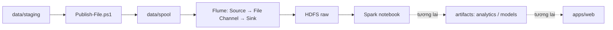

# Đồ án Big Data — ingestion và Spark EDA

Dataset hiện tại: `video_games_metadata/v1`. Luồng xử lý:



`apps/web`, `artifacts/analytics`, `artifacts/models` chỉ có file giữ chỗ. Chưa có web, model hoặc code EDA mới.

## Khởi chạy

Cần Docker Desktop chạy Linux containers/WSL2 và Docker Compose v2. Chạy PowerShell tại thư mục gốc:

```powershell
if (-not (Test-Path .env)) { Copy-Item .env.example .env }
docker compose config --quiet
docker compose up -d --build
docker compose ps -a
```

Các service `*-init` kết thúc với mã 0 là bình thường. NameNode UI: http://localhost:9870. Tên project `hadoop-demo` và tên volume hiện có được giữ để tái sử dụng dữ liệu.

## Nhập dữ liệu

Tải file UTF-8 JSON Lines vào `data/staging`. Một object mỗi dòng, tối đa 1 MiB/dòng, file đã giải nén và tải xong. Xem [manifest dataset](ingestion/manifests/video_games_metadata.v1.json); URL nguồn và ngày tải còn cần bổ sung.

```powershell
powershell -NoProfile -ExecutionPolicy Bypass -File .\ingestion\scripts\Publish-File.ps1 -File .\data\staging\meta_Video_Games.jsonl
docker compose logs --tail 100 flume
docker compose exec namenode hdfs dfs -ls -R /project/raw/video_games_metadata/v1
```

Máy hiện tại đã nhập dataset thật; không chạy publish lại chỉ để cập nhật cấu trúc. Mỗi lần publish tạo batch mới và có thể trùng dữ liệu. `.COMPLETED` chỉ xác nhận Source đã đọc vào channel; cần kiểm tra channel đã rỗng và HDFS không còn file `.tmp`.

## Spark notebook

```powershell
docker compose --profile eda up -d --build spark-notebook
docker compose exec spark-notebook jupyter server list
```

Mở URL bằng `localhost` và cổng `JUPYTER_PORT` trong `.env`, kèm token được in ra. Có thể kết nối VS Code tới server này. Mở `notebooks/01_eda.ipynb` và chạy setup trước. Token không được đưa lên GitHub.

```python
spark.conf.set("spark.sql.caseSensitive", "true")
df = spark.read.option("recursiveFileLookup", "true").json(
    "hdfs://namenode:8020/project/raw/video_games_metadata/v1"
)
df.printSchema()
df.show(5, truncate=80)
```

Dataset có khóa JSON khác nhau chỉ ở chữ hoa/thường; cần cấu hình trên trước khi đọc. Spark chạy local trong container và dùng RAM máy bạn. Colab chưa được kết nối tới HDFS trong cấu hình này.

## Thư mục

| Thư mục | Vai trò |
|---|---|
| `infrastructure/` | Image và cấu hình Hadoop, Flume, Spark, Graphify |
| `ingestion/` | Script nhập dữ liệu và manifest |
| `data/staging`, `data/spool` | Dữ liệu tải về và hàng đợi; không commit |
| `data/archive` | Smoke cũ, backup notebook; không commit |
| `tests/` | Fixture nhỏ và kiểm thử tích hợp |
| `notebooks/`, `outputs/eda/` | Notebook và kết quả EDA; output không commit |
| `apps/web/` | Giữ chỗ cho web demo |
| `artifacts/analytics`, `artifacts/models` | Kết quả phục vụ web, model; nội dung không commit |
| `docs/` | Kiến trúc, vận hành, lịch sử |
| `tools/graphify`, `graphify-out/` | Công cụ và bản đồ repository |

## Bản đồ Graphify

```powershell
docker compose --profile tools build graphify
powershell -NoProfile -ExecutionPolicy Bypass -File .\tools\graphify\Refresh-Graph.ps1
docker compose --profile tools run --rm --no-deps graphify query "Flume ingestion" --budget 1200
```

Workflow dùng AST và liên kết cấu hình xác định, không cần API LLM. Đọc [bản đồ ngắn](docs/project-map.md) trước, rồi tra graph và mở đúng file nguồn. Xem [Graphify](docs/graphify.md).

## Vận hành và chia sẻ

```powershell
docker compose --profile eda stop spark-notebook
docker compose --profile eda down
```

`down` giữ named volumes; `down -v` sẽ xóa dữ liệu HDFS và trạng thái Flume. Một DataNode, replication 1 phù hợp môi trường phát triển.

Đưa code, cấu hình, manifest, tài liệu và fixture nhỏ lên GitHub. Dataset, `.env`, token, output và model không đi theo Git hay Docker image. Bạn cùng nhóm cần tải dữ liệu và ingest trên máy họ. Xem [hướng dẫn GitHub](docs/github.md).

Tài liệu: [kiến trúc](docs/architecture.md), [lệnh và ý nghĩa](docs/commands.md), [quản lý dữ liệu](docs/data-management.md), [xử lý lỗi](docs/troubleshooting.md), [web demo về sau](docs/web-demo.md).
