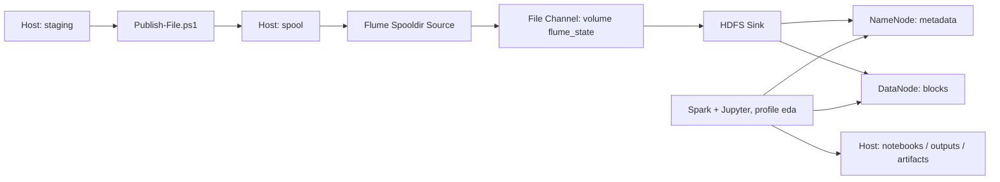

# Kiến trúc hiện tại

| Service | Vai trò | Khi chạy |
|---|---|---|
| `namenode` | Quản lý namespace và vị trí block | Mặc định |
| `datanode1` | Lưu block thật; giữ volume `hadoop-demo_datanode_data` | Mặc định |
| `flume` | Nhập event theo dòng | Mặc định |
| `namenode-init`, `datanode-init` | Chuẩn bị volume/quyền | One-shot |
| `hdfs-init` | Tạo đường dẫn dataset | One-shot |
| `flume-init` | Chuẩn bị state volume | One-shot |
| `spark-notebook` | Jupyter, PySpark local | Profile `eda` |
| `graphify` | Tạo và truy vấn bản đồ repository | Profile `tools`, chạy khi cần |

Một NameNode, một DataNode, replication 1. Chưa có HA, YARN, Spark worker riêng hoặc GPU. `local[*]` dùng CPU của container; giới hạn tài nguyên từ Compose và `.env`.

Có thể ghép `compose.datanodes.yaml` để chạy thêm `datanode2` và `datanode3`, mỗi node dùng volume riêng. Đây là tùy chọn; replication vẫn là `1` trừ khi được cấu hình riêng. Xem [hướng dẫn thêm DataNode](datanodes.md) để chạy và kiểm tra overlay an toàn.

Trong mạng Compose, Spark/Flume dùng `hdfs://namenode:8020`, DataNode được truy cập bằng hostname service. Trình duyệt trên host dùng `localhost` với port đã publish, mặc định NameNode 9870 và Jupyter 8888. URL trong container không phải URL dùng từ Colab.

Named volumes giữ metadata NameNode, block DataNode và channel Flume. Bind mounts giữ staging/spool, notebook, outputs, artifacts trên máy host. Không đổi tên volume hoặc format NameNode khi đổi thư mục dự án.

Source đọc từng dòng UTF-8. Channel lưu event bền vững; Sink gom thành file khoảng 128 MiB, đóng file idle sau 15 giây. File đang mở có hậu tố `.tmp`. Đây là event ingestion, không bảo toàn định dạng byte của file gốc hay bảo đảm thứ tự toàn cục.

HDFS `raw` giữ dữ liệu nhập; `processed` cho dữ liệu làm sạch; `analytics` cho tổng hợp. `artifacts/analytics` trên host là nơi xuất kết quả nhỏ cho web, khác HDFS analytics. `artifacts/models` dành cho model đã train và thông tin tiền xử lý.

Colab cloud cần gateway HDFS có kết nối được bảo vệ hoặc dữ liệu xuất ra storage dùng chung. Hạ tầng hiện tại chưa triển khai kết nối đó. Web về sau có thể đọc artifacts hoặc API inference; không cần chạy toàn bộ job Spark mỗi khi tải trang.
