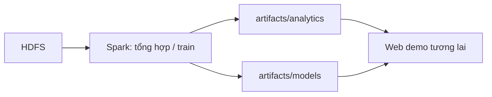

# Chuẩn bị web demo

`apps/web/`, `artifacts/analytics/`, `artifacts/models/` hiện chỉ có `.gitkeep`. Chưa tạo Dockerfile, requirements, code web hoặc service web trong Compose.

Khi triển khai, thêm code và Dockerfile trong `apps/web`, định nghĩa service, port và mount artifacts chỉ đọc nếu phù hợp. Với web đơn giản có thể gộp UI và backend; nếu cần API inference riêng thì tách service theo chức năng.

Web đọc kết quả tổng hợp sẵn hoặc gọi inference. Job EDA/train chạy riêng, tránh quét cả dataset cho mỗi request. Cần thống nhất schema analytics, version dataset/model, tiền xử lý, cách tải model và cập nhật artifacts trước khi viết giao diện. Có thể deploy web độc lập nếu artifacts đủ dùng, không bắt buộc mang toàn bộ HDFS lên hosting.
